> ⭐ **Multi-agent is now the default.** Run several Claude sessions side by side with an Agent inbox and groups for your terminals. **Prefer the single Pending Changes panel?** Open **Settings → Terminus → Experience** and choose **Classic** (or click **Switch to Classic** in the popup shown once after you update). [How to switch](#choose-your-experience) · [See what it does](#multi-agent-experience).

# Terminus

<p align="center">
  <a href="https://github.com/NoteNerdOfficial/terminus/commits/main"></a>
  <a href="https://github.com/NoteNerdOfficial/terminus/releases/latest"></a>
  <a href="https://obsidian.md/plugins?id=terminus"></a>
</p>

A real terminal inside Obsidian that never lets you lose the thread on what [Claude Code](https://claude.com/product/claude-code) just did. You type `claude` (or anything else) exactly like you would in any other terminal, with nothing wrapped or intercepted, and Claude keeps working through a whole multi-file turn uninterrupted. Two things happen because of that:

- **A command fails, and you don't leave the terminal to deal with it.** A small badge appears right next to the failed command. Click it and Claude explains what happened and proposes a fix, using the surrounding command history for context. No copying an error into a separate chat window and pasting the context back and forth by hand.
- **Claude finishes editing, and nothing is a mystery.** Every file it edits shows up in one Pending Changes panel, or on its session's card in Multi-agent (what changed, where, and by how much), with a real line-numbered diff per file and Accept / Reject / Open right there. No more hunting for "where did that change happen"; even editor plugins built specifically for opening code in Obsidian don't show you a diff, and Terminus does.

Edits land on disk immediately; you review what changed afterwards, with the option to revert.

Terminus opens in the **Multi-agent experience**: an Agent inbox with a card per Claude session, and groups to keep related terminals together. Prefer one Pending Changes panel? You can switch to Classic any time. See [Choose your experience](#choose-your-experience).

<p align="center">
  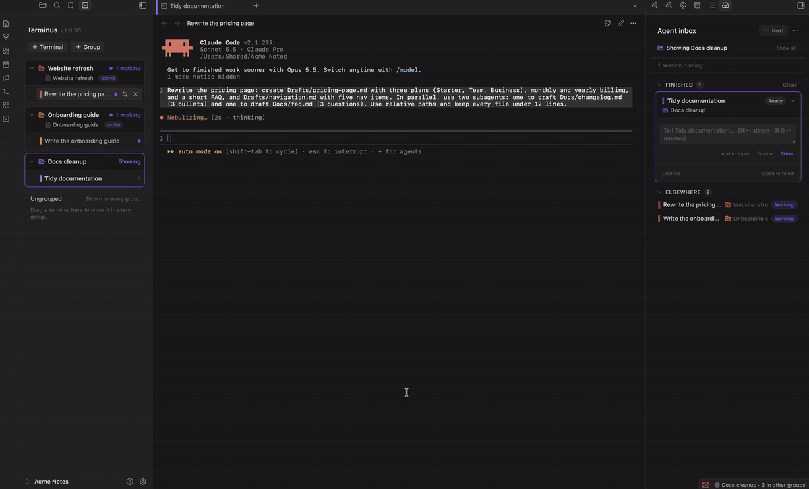
</p>

*Three sessions at once. Groups on the left show who is working and who needs you; the Agent inbox lists what each changed. One session asks for permission, and **Next** jumps straight to it.*

## Contents

- [Choose your experience](#choose-your-experience): Classic or Multi-agent, and how to switch
- [Both experiences](#both-experiences)
  - [Terminal](#terminal)
  - [Terminal help for beginners](#terminal-help-for-beginners)
- [Classic experience](#classic-experience)
  - [Claude Code review workflow](#claude-code-review-workflow)
- [Multi-agent experience](#multi-agent-experience)
  - [Groups (left sidebar)](#groups-left-sidebar)
  - [Agent inbox (right sidebar)](#agent-inbox-right-sidebar)
- [Commands](#commands)
- [How it works](#how-it-works)
- [Requirements](#requirements)
- [Development](#development)
- [Layout](#layout)
- [License](#license)

## Choose your experience

Terminus has two experiences. They share the same terminal, the same hooks and the same pending changes; they differ in how you keep track of Claude's work.

| | **Classic** | **Multi-agent** |
| --- | --- | --- |
| Best for | One Claude session at a time, or a few you watch yourself | Several Claude sessions running side by side |
| Where you review | One **Pending Changes** panel, grouped by terminal | An **Agent inbox** with a card per session, and **groups** for your terminals |
| Organising terminals | Tabs, names and colours | Groups, snooze and settle, a "go to" picker, forking and sending tasks between sessions |
| Talking to a running session | Type in its terminal | A steer / queue box on each card |
| Default | Opt in | Yes (new installs and updates) |

**To switch:** open **Settings → Terminus → Experience** and pick **Classic** or **Multi-agent**. Switching is instant and reversible: terminals, pending changes and every other setting carry over, and each experience keeps its own review settings.

**Updating from an earlier version?** If you hadn't chosen an experience yet, Terminus moves you to Multi-agent once and shows a popup with a **Switch to Classic** button. If you had already declined Multi-agent or picked Classic yourself, nothing changes.

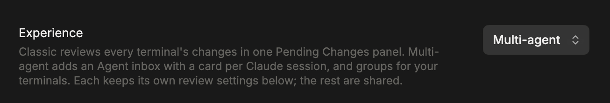

## Both experiences

### Terminal

- **A real PTY-backed terminal.** Full interactive shell (zsh/bash), not a fake console. Run anything, not just `claude`.
- **Multiple concurrent terminals.** Open as many as you want; each runs its own session, defaulting to a numbered label ("Terminus 1", "Terminus 2", ...).
- **Rename and color-code terminals.** A pencil and palette icon in each terminal's own header let you give it a custom name and a color tag. Both show on the terminal's native tab, carry through into its Pending Changes group so you can tell at a glance which session made which edits, and survive an Obsidian restart (or a "Rescue closed terminal", below).
- **Choose where a new terminal opens.** Clicking the ribbon icon shows a quick menu: new tab, split right, split down, or new window. Set a fixed default in Settings to skip the menu entirely, or use the "Open in new tab" / "Open in split right" / "Open in split down" / "Open in new window" commands to go straight to a placement (each can take its own hotkey).
- **Clickable paths and URLs.** `Cmd/Ctrl` + click a file path or link in terminal output to open it. Files in your vault open in a new tab — notes as notes, and anything else in whichever editor has claimed that extension — with a trailing `:42` (the form compilers, linters and Claude all print) landing on that line; URLs open in your browser; anything Obsidian can't open at all, including dot-files and paths outside the vault, goes to your system's default app. Paths are checked against disk before being linkified, so prose and version numbers don't turn into false links.
- **Drag-and-drop path insertion.** Drag a note from Obsidian's file explorer, or a file from Finder/Explorer, onto a terminal to insert its absolute path into the input line (quoted if it has spaces), unexecuted.
- **Wiki-link autocomplete.** Type `[[` in a terminal to fuzzy-search your vault's notes and insert one as a wiki-link, a vault-relative path, or an absolute path, configurable in Settings.
- **Scrollback and working-directory persistence.** Closing and reopening Obsidian restores what was on screen (clearly marked as a previous session) and resumes each shell in the same directory you left it in, not the vault root.
- **Rescue closed terminals.** Closed a tab by accident? The "Rescue closed terminal" command brings back its transcript, working directory, name, and color from a 10-entry buffer.
- **Startup command.** Optionally run a fixed command (e.g. `claude`) automatically in every new terminal once its shell is ready.
- **Deep appearance settings.** Font size and family, cursor style and blink, scrollback size, and a customizable ribbon icon, plus a terminal color theme that follows Obsidian's light/dark toggle automatically. Font size also has its own increase/decrease/reset commands, which apply live to every open terminal.

### Terminal help for beginners

- **Shell integration** (zsh and bash) tracks every command's boundaries and exit code, without modifying your actual `.zshrc`/`.bashrc`.
- **Failure badges.** A small ⚠ appears next to any command that exits non-zero.
- **Explain this.** Click the badge for a plain-English explanation of what happened, from an isolated `claude -p` call with no file/tool access. Its result has a fixed spot above the action buttons and stays there regardless of what else you do in the popup. Both this and Suggest a fix see not just the failed command but a few commands run right before it too, so a failure that's really about an earlier step (e.g. a `git push` failing because nothing was committed yet) gets diagnosed with that context, not just the last line.
- **Suggest a fix.** Asks Claude for its single best corrective command with a one-sentence rationale, shown below the action buttons with its own Apply/Cancel. Apply types it into your terminal's input line, unexecuted, so you review, edit, or press Enter yourself. Clicking "Suggest a fix" again gets the next-best option instead of repeating itself. Claude never runs anything on its own here.

### Screenshots

| Command help: Explain / Suggest a fix |
| --- |
|  |

| Rename a terminal |
| --- |
| 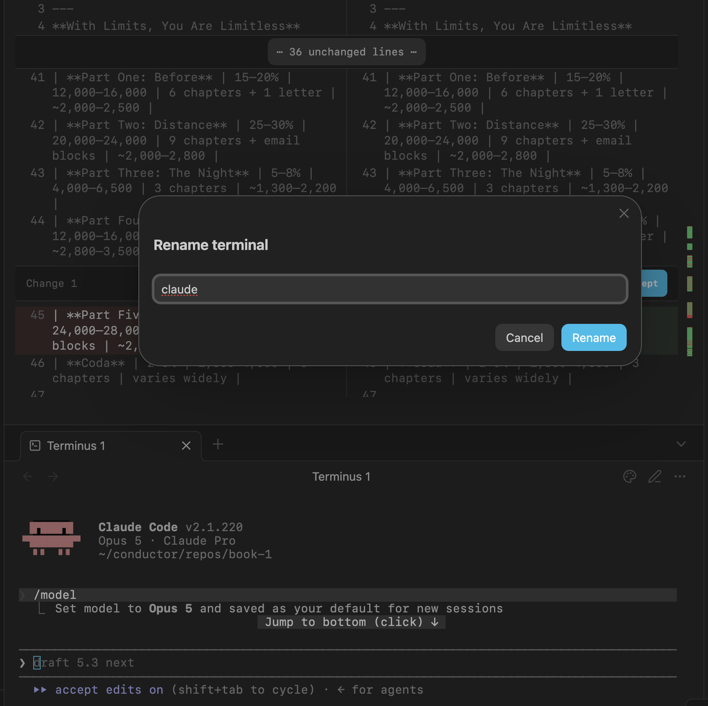 |

| Color-code a terminal, with the tint carried to its native tab |
| --- |
| 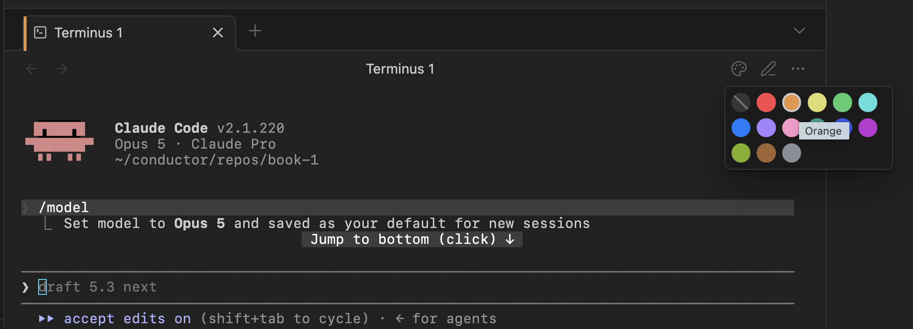 |

## Classic experience

The single-panel experience. Every file Claude edits lands in one **Pending Changes** panel, grouped by terminal, where you accept or reject it after the fact. Edits land on disk immediately and nothing is blocked. (Multi-agent reviews through the same hooks and the same diff views; it just presents them per session in the inbox.)

### Screenshots

| Split Diff: per-hunk Accept/Reject |
| --- |
| 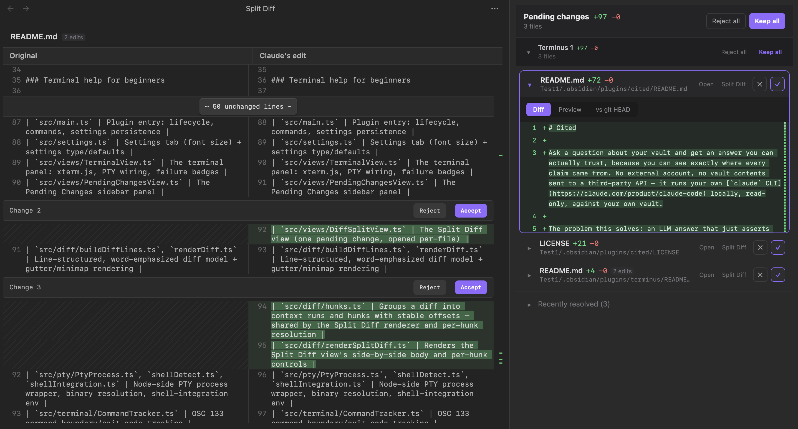 |

### Claude Code review workflow

- **Non-blocking by design.** A `PreToolUse` hook records the pre-edit snapshot of every file Claude touches, but never blocks the write. Claude finishes its whole turn; you review afterward.
- **Live "Claude is editing X" chip.** A pulsing dot and the file currently being written, floating in the bottom-right of the terminal right by Claude's own input box, collapsing to a count once a turn touches more than one. It's up for the whole turn — including the stretches where Claude is thinking or running tools that aren't writes — because a `Stop` hook tells the plugin when the turn actually ends. The dot carries that terminal's own color, so it's clear which session is busy.
- **Blinking "needs attention" dot on the tab.** Lights up on a terminal's native tab the moment Claude needs permission to use a tool, or has gone idle waiting on you — the case a floating chip inside the pane can't help with, since you only see that if you're already looking at the right tab. Positioned to stay visible even when several tabs are open and the title text itself has truncated. Clears as soon as you focus that tab, or on its own once the turn ends.
- **Pending Changes panel.** A persistent sidebar panel, grouped by terminal (each group collapsible independently), showing every file changed with a line-numbered, word-level diff and a scroll minimap. Colors follow your vault's accent color rather than a fixed theme.
- **Comes to front automatically.** Once Claude finishes a burst of edits, the panel reveals itself (debounced across a whole multi-file turn, so it doesn't interrupt mid-turn or pop up once per file). Toggleable in Settings, with an adjustable delay.
- **Accept / Reject, per file or in bulk.** Accept is a no-op (the file's already correct); Reject reverts to the exact pre-edit content, or deletes the file if it was newly created. A global "Reject all" / "Keep all" covers everything; each terminal group also gets its own scoped (visually secondary) versions. Optionally require a confirmation before any bulk action, off by default since every one is already reversible via "Recently resolved".
- **Edits coalesce within a turn.** Multiple edits to the same file in one turn merge into a single row with one true revert point, instead of several overlapping ones.
- **Undo, even after Accept.** A "Recently resolved" list lets you reverse either outcome after the fact.
- **Persistent, searchable action log.** A lightweight on-disk history (filename, stats, outcome) that survives Obsidian restarts, independent of the short in-memory undo list.
- **Rendered markdown preview.** Toggle a pending change's diff view to see the note as it will actually render, not just raw markdown text.
- **Git-aware baseline.** For a vault under version control, an extra "vs git HEAD" diff view alongside the since-last-edit one (purely informational).
- **Backlink-breakage warnings.** Flags when an edit removes a heading or block that other notes reference via `[[Note#Heading]]` or `[[Note#^block]]`.
- **Inline in-editor diff.** Click "Open" on a pending change to open the file, with the diff marked up directly in the real note and Accept/Reject controls right there. The editor lands on the first changed hunk rather than the top of the file. "Open" always just opens: a file another plugin handles (a code editor for `.ts`, say) opens in that editor without the inline markup rather than being swapped for another view, and files Obsidian can't open at all — dot-files, paths outside the vault — go to your system's default app, the same as a `Cmd`-clicked path in the terminal.
- **Split Diff view, with per-hunk Accept/Reject.** Click "Split Diff" on a pending change for a dedicated side-by-side (old | new) view with its own Accept/Reject bar on every individual changed block, so you can keep some edits and revert others within the same file instead of an all-or-nothing per-file decision. Not available for `NotebookEdit` changes, since their diff is a display-only approximation of the real file content and can't be safely spliced.
- **Keyboard-driven review.** Accept/reject the oldest pending change without touching the panel.

## Multi-agent experience

Multi-agent is the default: it lets you run several Claude sessions side by side without losing track of them. If you would rather have Classic's single Pending Changes panel, [switch back](#choose-your-experience) in Settings → Terminus → Experience. The two share your terminals, pending changes and every other setting, and each keeps its own review settings.

### Screenshots

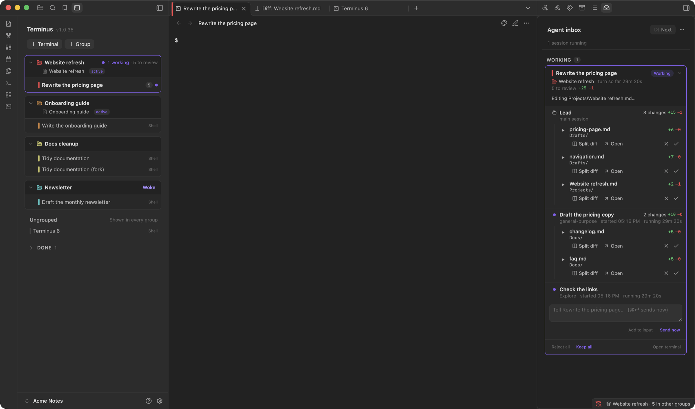

*Groups on the left, and the Agent inbox on the right following the selected group. The working session's changes hang under the lead and each subagent that made them.*

| Steer a running session, or queue messages for when its turn ends |
| --- |
| 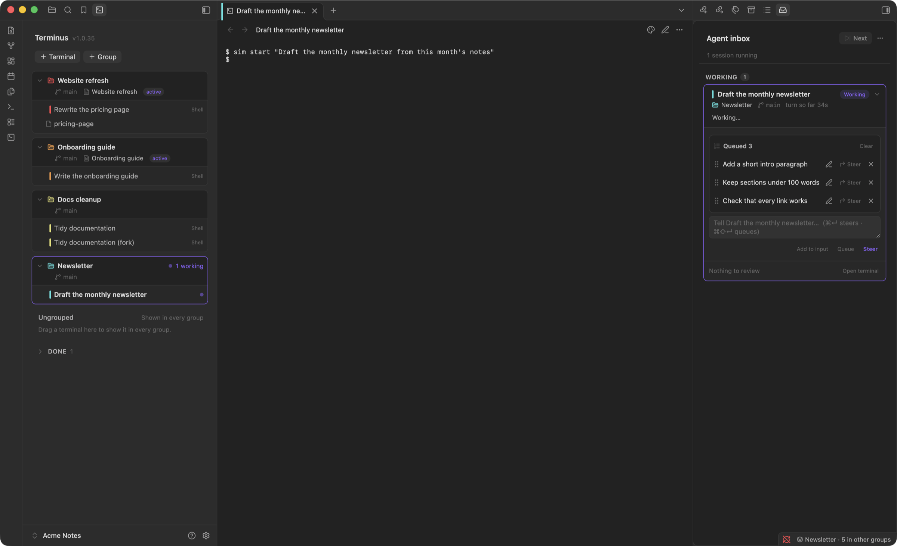 |

| Reorder, edit and steer queued messages |
| --- |
| 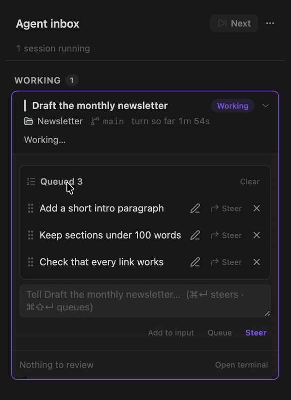 |

| Fork a session into a new terminal |
| --- |
| 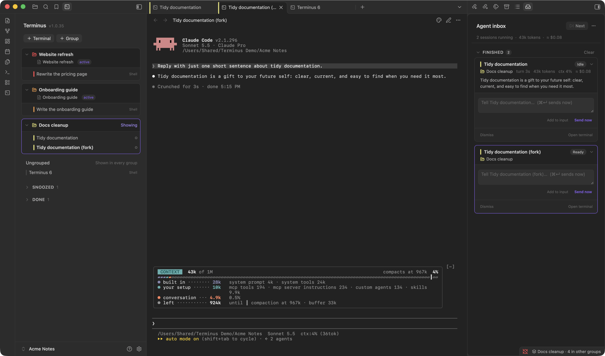 |

| Send a task to a new terminal |
| --- |
| 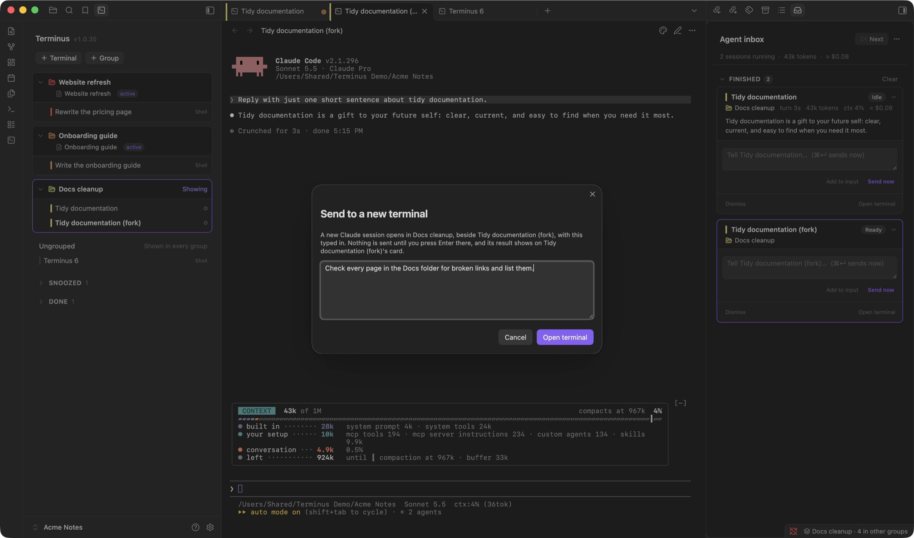 |

| Snooze a group until later |
| --- |
| 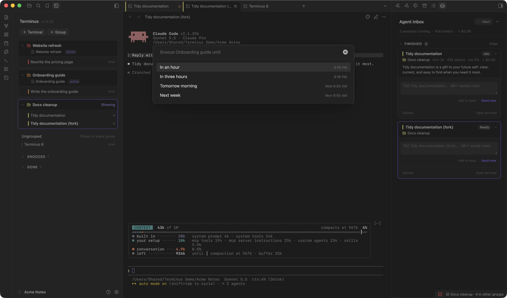 |

| Review a change hunk by hunk from the inbox |
| --- |
| 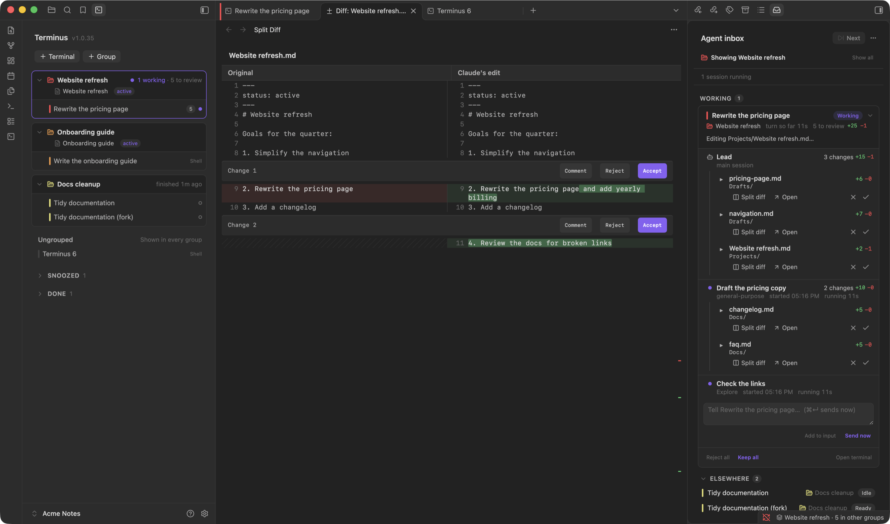 |

### Groups (left sidebar)

- **A group is one piece of work.** It holds the terminals for that task, plus the notes you have open in it. Selecting a group shows only its terminals in the editor; the others keep running in the background. Terminals outside any group show in every group.
- **Named for you.** A group takes its name from what Claude is working on, then your folder or note, unless you type one. A coloured folder marks the group; each terminal keeps its own colour stripe, like its tab.
- **At a glance.** A group's row says what is happening in it (needs attention, N working, N to review, or when its last turn finished), with one status dot for the most urgent session. Click "N to review" to open the inbox at that terminal.
- **Link a note.** A group can link to a note and show its `status`. When a turn ends with the note `active`, Terminus suggests moving it to `review` (and back); it never changes the note on its own.
- **Settle or snooze.** *Settle* puts a finished group away on a Done shelf without closing its terminals; it comes back out by itself when a session in it starts working or needs you. *Snooze* hides a group until a time you pick; it comes back sooner if a session in it needs you or finishes a turn, marked "Woke". Neither is allowed while a session is waiting on a permission prompt.
- **Organise.** Drag terminals between groups, drag a group's row (or use Move up / Move down) to reorder, and ⌘/Ctrl-click terminals then "Group selected" to gather them.
- **Choose where a terminal opens.** + Terminal follows the Terminal placement setting, with the same menu as the ribbon icon (new tab, split right, split down, new window).
- **Go anywhere.** "Go to terminal or group…" is a fuzzy picker over every terminal and group, urgent ones first.

### Agent inbox (right sidebar)

- **A card per Claude session**, sorted into Needs attention, Working and Finished, with what it is doing (or its closing message), how long its turn took, its git branch, and tokens, context use and an estimated cost from its transcript.
- **It follows the sidebar.** The inbox shows the selected group; sessions in other groups are listed in one line each under Elsewhere, and a line says how many of them need you. **Show all** lists everything.
- **Changes sit under whoever made them.** A session's pending changes are listed under the lead or the subagent that made them, with the subagent's task as its name and live timers. A long list over several folders groups under foldable folders.
- **Tell a running session something.** Each card has a box with three ways to deliver a message: *Steer* types it into the session's input line and presses Enter, and Claude folds it into the turn it is working on; *Queue* holds it until the turn ends; *Add to input* types it for you to review and send. Steering works mid-turn and is refused only while Claude waits on a prompt. Cmd/Ctrl+Enter does your default (Settings → Terminus → Default for messages to a running session) and Cmd/Ctrl+Shift+Enter does the other. Drafts survive re-renders.
- **A queue you can manage.** Queued messages are listed above the box in the order they will go. Drag to reorder, edit in place, remove, or promote one with *Steer* to send it now. When a turn ends, the next queued message is sent, one per turn, unless Claude is waiting on a prompt or the last turn failed (the card says why). The queue is saved with the terminal, so it survives a restart, and comes back paused with a *Resume* button.
- **Send a task to a new terminal.** Opens a new Claude session beside the sender with your prompt typed in, unsent. Its result shows on the sender's card, and one click types it back into the sender's input line.
- **Fork a session.** Starts a new terminal in the same group continuing from this session's conversation (`claude --resume <id> --fork-session`), named "(fork)".
- **Review feedback.** Comment on a hunk in Split Diff, queue comments per session, and type them into that session's input line between turns.
- **Quiet by default.** An inbox you already have open only comes forward after a meaningful burst of edits (three files or 50 lines), and never while you are rearranging it. Terminus never submits anything for you except when you press Steer (or send a queued message).

## Commands

All of these appear in the command palette under `Terminus:`. None ship with a default hotkey — Obsidian's plugin guidelines advise against claiming key combinations on a user's behalf — so assign your own in **Settings → Hotkeys** for any you use often.

| Command |
| --- |
| Open |
| Open in new tab |
| Open in split right |
| Open in split down |
| Open in new window |
| Open Pending Changes |
| Open agent inbox |
| Jump to next session that needs attention |
| Open Action Log |
| Getting started |
| Rescue closed terminal |
| Increase terminal font size |
| Decrease terminal font size |
| Reset terminal font size |
| Accept oldest pending change |
| Reject oldest pending change |
| Keep all pending changes |
| Reject all pending changes |
| New group *(Multi-agent)* |
| Switch group… *(Multi-agent)* |
| Go to terminal or group… *(Multi-agent)* |
| Move tab to group… *(Multi-agent)* |
| Close group *(Multi-agent)* |
| Start Claude on this note *(Multi-agent)* |
| Send a task to a new terminal… *(Multi-agent)* |

## How it works

**Review workflow.** The plugin auto-provisions a project-scoped `.claude/settings.local.json` in your vault wiring a `PreToolUse` hook (matching `Edit|Write|NotebookEdit`) to a bundled script. That script POSTs the tool call to a local, loopback-only HTTP server the plugin runs, which records the file's current content (before the write happens) and lets the hook return immediately, so Claude is never blocked. Rejecting a change later writes that recorded content back to disk.

**Knowing when a turn ends.** The same file also gets a `Stop` hook, pointing at a second bundled script that pings the same server when Claude finishes a turn. Nothing in the `PreToolUse` stream can express "no more writes are coming" — a turn goes quiet whenever Claude is thinking or running non-write tools — so without it the activity chip has to guess with a timer and either drops mid-turn or lingers past the end. It's a bodyless ping that writes nothing to stdout, since a `Stop` hook's stdout is how a hook tells Claude Code to *block* stopping.

**Knowing when Claude needs you.** A third hook, `Notification`, points at a third bundled script and fires whenever Claude Code needs permission to use a tool or has sat idle waiting on input. Both are "a human needs to look here" moments, so either one lights up that terminal's tab dot the same way, without the plugin parsing the notification's message text. The `Stop` hook (above) or focusing that tab, whichever comes first, clears it again.

**Multi-agent.** The Multi-agent experience adds hooks for `SessionStart`, `SessionEnd`, `UserPromptSubmit` and `StopFailure` (and, while subagents are tracked, the Agent tool's `PreToolUse`, `SubagentStart` and `SubagentStop`) to the same bundled bridge scripts. Every event carries its terminal's own token, so a session, its subagents and their edits are always attributed to the right terminal. Nothing polls. If your vault path contains a space, the hook commands are written single-quoted so the shell runs them correctly.

All three hooks are added without disturbing anything already in that file, and Claude Code reads hooks at session start — so a `claude` that was already running when the plugin first provisioned them picks them up on its next start.

**Terminal.** There's no native-addon PTY dependency (no `node-pty`, no Electron-ABI rebuild headaches). A small bundled Python script (`resources/pty_helper.py`) allocates a real pseudo-terminal via Python's stdlib and proxies bytes between the PTY and its own stdio; the plugin talks to it with a plain `child_process.spawn`. The terminal UI is `xterm.js`.

**Shell integration.** Two tiny rc scripts (`resources/shell-integration/{zsh,bash}/`) get sourced by redirecting `ZDOTDIR` (zsh) or `HOME` (bash) for the *spawned shell only*, never the plugin's own Python helper process, restoring the real value immediately and chain-loading your actual `.zshrc`/`.bash_profile` before adding invisible `OSC 133` command-boundary markers and an `OSC 7` current-directory marker around each prompt. Nothing on disk is modified.

**Command help.** "Explain this" and "Suggest a fix" are standalone `claude -p` calls with `--allowedTools ""` (no file or shell access, pure Q&A), independent of whatever's running in any terminal, so they work even if no terminal has `claude` open at all.

**Wiki-link autocomplete.** A real terminal has no local echo: everything on screen is echoed back by the *remote* shell's own readline, not rendered by the plugin. So typing `[[` can't be reacted to after the fact; it's intercepted before either character ever reaches the shell, and a resolved link/path is written in its place only once you actually pick one.

## Requirements

- macOS or Linux (Windows isn't supported; shell integration and the PTY helper are Unix-specific).
- Python 3.9+ (`pty_helper.py` uses `os.waitstatus_to_exitcode`, added in 3.9) and the [`claude` CLI](https://claude.com/product/claude-code) installed and logged in. Both are auto-detected (including a login-shell `PATH` lookup, since Obsidian launched from Finder/Dock often inherits a minimal one); if detection ever picks the wrong binary, Settings has manual overrides for the shell and Python 3 paths.
- On some machines, Claude Code's normal Keychain-based login can't be read by "Explain this" / "Suggest a fix" (a spawned background process asking for another app's Keychain item can hang indefinitely). If those hang or fail, run `claude setup-token` in a real terminal and paste the result into Settings → Advanced → "Claude Code auth token", then use the Test button next to it to confirm -- takes effect immediately, no restart needed.
- `git` is optional, only needed for the "vs git HEAD" diff view.

## Development

```sh
npm install
npm run dev    # unminified build with inline sourcemaps
npm run build  # typecheck + minified production build
```

The build bundles `src/main.ts` into `main.js` with esbuild, and regenerates `styles.css` from `src/css/custom.css` plus xterm.js's own stylesheet. Copy (or symlink) the plugin folder into `<vault>/.obsidian/plugins/terminus/` and enable it in **Settings → Community plugins**.

## Layout

| Path | Role |
| --- | --- |
| `src/main.ts` | Plugin entry: lifecycle, commands, settings persistence |
| `src/settings.ts` | Settings tab + settings type/defaults |
| `src/views/TerminalView.ts` | The terminal panel: xterm.js, PTY wiring, failure badges, rename/color identity |
| `src/views/PendingChangesView.ts` | The Pending Changes sidebar panel |
| `src/views/AgentInboxView.ts`, `TerminusSidebarView.ts` | Multi-agent: the Agent inbox (right) and the groups sidebar (left) |
| `src/groups/` | Group logic: controller, menus, naming, notes, snooze presets, tab visibility, fork command, the "Go to terminal or group" picker |
| `src/state/AgentSessionStore.ts`, `GroupStore.ts`, `InboxUiState.ts`, `DelegationStore.ts`, `inboxModel.ts` | Session status, groups, how the inbox is arranged, delegated tasks, and sorting sessions into cards |
| `src/views/DiffSplitView.ts` | The Split Diff view (one pending change, opened per-file) |
| `src/diff/buildDiffLines.ts`, `renderDiff.ts` | Line-structured, word-emphasized diff model + gutter/minimap rendering |
| `src/diff/hunks.ts` | Groups a diff into context runs and hunks with stable offsets, shared by the Split Diff renderer and per-hunk resolution |
| `src/diff/renderSplitDiff.ts` | Renders the Split Diff view's side-by-side body and per-hunk controls |
| `src/pty/PtyProcess.ts`, `shellDetect.ts`, `shellIntegration.ts` | Node-side PTY process wrapper, binary resolution, shell-integration env |
| `src/terminal/oscHandler.ts` | Shared workaround for xterm.js's non-functional public `registerOscHandler` |
| `src/terminal/CommandTracker.ts` | OSC 133 command-boundary/exit-code tracking |
| `src/terminal/CwdTracker.ts` | OSC 7 working-directory tracking |
| `src/terminal/TerminalLinks.ts` | Clickable file paths and URLs in terminal output |
| `src/terminal/fontCatalog.ts` | Installed-monospace-font detection for the settings dropdown |
| `src/terminal/WikiLinkAutocomplete.ts` | `[[` fuzzy note picker inside the terminal |
| `src/terminal/TerminalColorPicker.ts`, `colorPalette.ts`, `tabHeaderColor.ts` | Color-swatch popover, preset palette, and the native-tab tint/title-refresh/needs-attention dot |
| `src/server/ReviewServer.ts`, `diff.ts` | Local hook-bridge HTTP server, diff computation |
| `src/state/PendingChangesStore.ts`, `ActionLog.ts` | In-memory pending/undo state, persisted action log |
| `src/state/ClosedTerminalBuffer.ts` | Ring buffer backing "Rescue closed terminal" |
| `src/hooks/provisionSettings.ts`, `provisionResources.ts`, `types.ts` | `.claude/settings.local.json` provisioning, writing `resources/` out on load, hook payload types |
| `src/editor/inlineDiff.ts`, `openWithDiff.ts` | CodeMirror 6 inline diff overlay, and opening a changed file |
| `src/util/systemOpen.ts` | Handing a file to the OS, for paths Obsidian can't open in a leaf |
| `src/onboarding/gettingStarted.ts` | Bundled first-run and getting-started copy |
| `src/backlinks/breakage.ts` | Backlink-breakage detection |
| `src/git/gitDiff.ts` | Git HEAD baseline diff |
| `src/claude/headlessAssist.ts` | Standalone `claude -p` calls for explain/suggest-fix |
| `src/modals/` | Action log, command-help, confirm, rename, rescue-terminal, and getting-started modals |
| `resources/pty_helper.py` | PTY allocation helper (spawned by the plugin) |
| `resources/hook-bridge.sh` | `PreToolUse` hook → local server bridge |
| `resources/turn-end-bridge.sh` | `Stop` hook → local server bridge (end of turn) |
| `resources/notification-bridge.sh` | `Notification` hook → local server bridge (needs-attention dot) |
| `resources/shell-integration/{zsh,bash}/` | Shell rc scripts for command tracking and cwd tracking |

## License

MIT. See [LICENSE](LICENSE).
